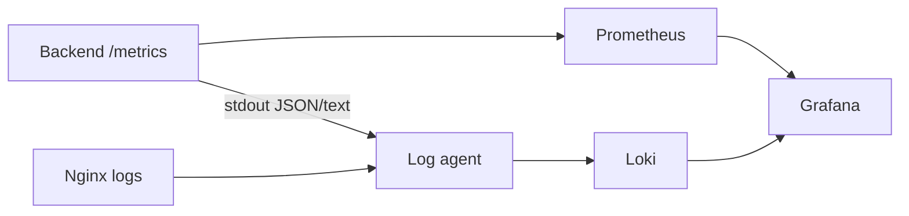

# Наблюдаемость и эксплуатация

## Что доступно сейчас

| Сигнал | Реализация | Где смотреть |
|---|---|---|
| Application logs | Структурированные записи Go `slog` | stdout backend-контейнера |
| Access logs | event, operation, user_id, request_id, method, route, path, status, duration_ms, bytes, outcome | stdout backend-контейнера |
| Error logs | operation, internal error и business identifiers | stdout backend-контейнера |
| Request correlation | `X-Request-ID` в запросе/ответе и `requestId` в ошибке | UI, Network, backend logs |
| Health | `GET /health` | Docker healthcheck и мониторинг |
| Metrics | Prometheus text format на `GET /metrics` | браузер/curl, далее Prometheus |

Текущие метрики находятся в памяти процесса: количество запросов, 5xx, panic, активные запросы и суммарная длительность.

## Поиск ошибки пользователя

1. Получить `requestId` из уведомления frontend или ответа в DevTools Network.
2. Найти backend log с полем `request_id`.
3. Проверить `operation`, `user_id`, `status`, `duration_ms`, `outcome`, `error_code` и `reason`.
4. По `operation` определить handler/use case, где произошла ошибка.
5. Сопоставить время с логами PostgreSQL, Nginx или storage, если сбой внешний.

`500` намеренно не раскрывает детали клиенту. Полная причина должна быть в backend log с тем же request ID.

## Как читать новые логи

Одна строка stdout — один JSON-объект. `msg` написано по-русски для чтения человеком, `event` и `operation` — стабильные имена для поиска.

Пример успешного сохранения ячейки (ID условные):

```json
{"time":"2026-10-18T12:00:00Z","level":"INFO","msg":"Значение ячейки сохранено","service":"trade-diary-backend","environment":"production","request_id":"demo-123","method":"PATCH","path":"/journals/j1/rows/r1/cells/c1","event":"http.request.completed","user_id":"u1","operation":"cell.update","route":"/journals/{journalID}/rows/{rowID}/cells/{columnID}","outcome":"success","status":204,"bytes":0,"duration_ms":18.4,"journal_id":"j1","row_id":"r1","column_id":"c1"}
```

| Поле | Как его понимать |
|---|---|
| `time`, `level`, `msg` | Когда произошло событие, его важность и объяснение |
| `event` | Этап: `http.request.started`, `http.request.completed`, `http.request.failed`, `http.request.panicked` |
| `operation` | Что делал пользователь: `auth.login`, `journal.create`, `column.update`, `row.create`, `row.delete`, `cell.update`, `cell.clear`, `attachment.upload`, `attachment.delete`, `analytics.get` |
| `request_id` | Объединяет все записи одного HTTP-запроса; возвращается в `X-Request-ID` и `requestId` в JSON-ошибке |
| `user_id` | ID пользователя, определённого по серверной сессии. Пустая строка означает, что пользователь ещё не определён или не авторизован |
| `route` / `path` | Шаблон маршрута / фактический путь; query-параметры не записываются |
| `outcome` | `success` — выполнено; `rejected` — ошибка клиента (4xx); `failed` — внутренняя ошибка, panic или обрыв передачи файла |
| `duration_ms` | Полное время обработки запроса в миллисекундах, включая загрузку и отправку данных |
| `status`, `bytes` | HTTP-статус и количество отправленных байтов. После начала передачи статус уже нельзя заменить: при обрыве проверяйте также `outcome` |
| `journal_id`, `row_id`, `column_id`, `attachment_id` | Какой объект затронут. Создание записывает ID нового объекта |
| `result_count` | Сколько журналов, колонок или наблюдений вернул список |
| `file_size_bytes`, `mime_type` | Размер и тип успешно загруженного скриншота |
| `error_code`, `reason` | Код ошибки API и краткая причина, например `INVALID_CELL_VALUE` / `invalid cell value` |
| `error`, `stack` | Внутренняя причина сбоя; stack добавляется при panic |

Сначала появляется `http.request.started`: сессию на этом этапе ещё не проверяли, поэтому `user_id` пустой. В завершающей записи после успешной проверки сессии будет ID пользователя. Регистрация, вход и выход также указывают известный серверу ID. Ошибочная попытка входа не приписывается пользователю по введённому email.

`INFO` — обычная работа; `WARN` — запрос отклонён (например, неверное значение, отсутствие сессии или удалённая строка); `ERROR` — сбой сервера. При внутренней ошибке сначала записывается `http.request.failed` с технической причиной, затем `http.request.completed` с итогом. У них одинаковый `request_id`.

Запросы к неизвестным URL (404), неподдерживаемые методы (405) и CORS preflight тоже получают ID и итоговый лог. У незнакомого маршрута операция `http.unmatched`, у preflight — `http.preflight`. Успешные `/health` и `/metrics` не засоряют stdout, но учитываются в метриках.

Не записываются тела запросов/ответов, значения ячеек, названия журналов и файлов, email, пароли, заголовки авторизации и cookies. Технические ошибки и stack trace предназначены для разработчика. Входящий `X-Request-ID` принимается только длиной до 128 символов из букв, цифр, `-`, `_`, `.`; иначе сервер создаёт новый ID. CORS разрешает передавать и читать этот заголовок в браузере.

## Команды для локальной диагностики

Выполнять из корня проекта:

```powershell
# Последние записи и дальнейшие события в реальном времени
docker compose logs --tail=100 -f --no-color --no-log-prefix backend

# Все записи запроса из уведомления об ошибке
docker compose logs --no-color --no-log-prefix backend | Select-String '"request_id":"demo-123"'

# Действия конкретного пользователя
docker compose logs --no-color --no-log-prefix backend | Select-String '"user_id":"u1"'

# Только завершённые загрузки скриншотов (успешные и ошибочные)
docker compose logs --no-color --no-log-prefix backend | Select-String '"operation":"attachment.upload"'
```

Если загрузка долго не заканчивается: найдите `http.request.started`, скопируйте `request_id` и проверьте, появилась ли завершающая запись. Если её ещё нет, запрос остаётся в обработке либо процесс был прерван. Если завершился — смотрите `duration_ms`, `status`, `outcome` и `reason`.

События запуска идут в таком порядке: `app.starting` → `database.connected` → `storage.ready` → `http.server.started`. Последнее пишется только после успешного открытия HTTP-порта. При штатной остановке: `app.stopping` → `http.server.stopped` → `app.stopped`; при ошибке — `app.failed`. У событий процесса нет `request_id` и `user_id`, потому что они не относятся к HTTP-запросу. Строка подключения PostgreSQL намеренно не записывается.

## Граница Nginx и backend

Ошибка может возникнуть до Go API. Например, Nginx возвращает `413`, если HTTP body превышает `client_max_body_size`; backend в таком случае не получает запрос и не создаёт свой access log. Диагностика всегда начинается с определения компонента, сформировавшего ответ.

## Prometheus, Loki и Grafana



- Prometheus периодически собирает числовые метрики.
- Loki хранит и индексирует логи по labels.
- Grafana показывает dashboards и позволяет переходить от всплеска 5xx к логам.
- Alertmanager добавляется для уведомлений о недоступности, росте ошибок и latency.

Подключение этих сервисов — следующий инфраструктурный этап; текущий `/metrics` является минимальной точкой интеграции, но ещё не заменяет production monitoring.

## Минимальные production alerts

- backend или frontend healthcheck недоступен;
- доля 5xx превышает порог;
- p95 latency растёт;
- PostgreSQL недоступен или заканчиваются соединения;
- заканчивается место в PostgreSQL/storage;
- миграция завершилась ошибкой или схема находится в dirty-state;
- растёт количество panic.

## Миграции и запуск

В Compose сервис `migrate` ждёт healthy PostgreSQL и применяет миграции до старта backend. Backend запускается только после успешного завершения миграций. Frontend, в свою очередь, ждёт healthy backend.

## Резервное копирование

Для восстановления нужны согласованные копии PostgreSQL и volume изображений. Резервная копия только базы сохранит metadata, но не содержимое скриншотов; копия только storage потеряет связи и владельцев.
